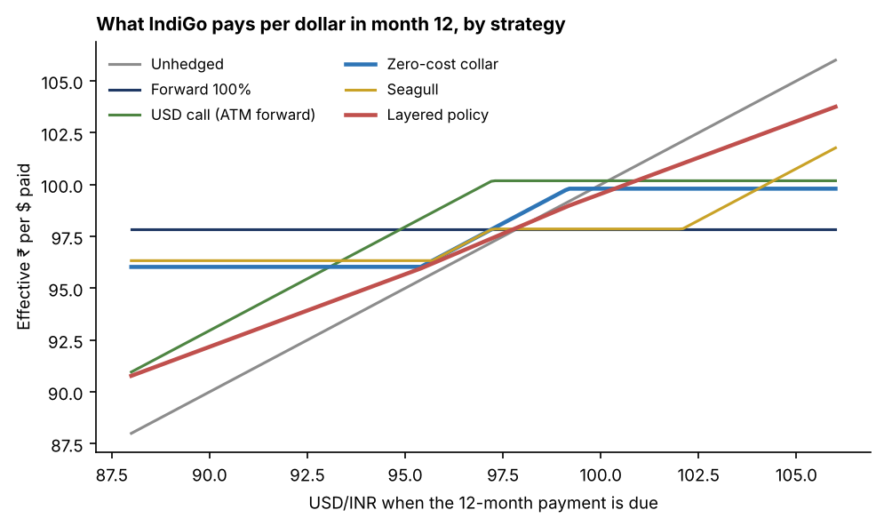
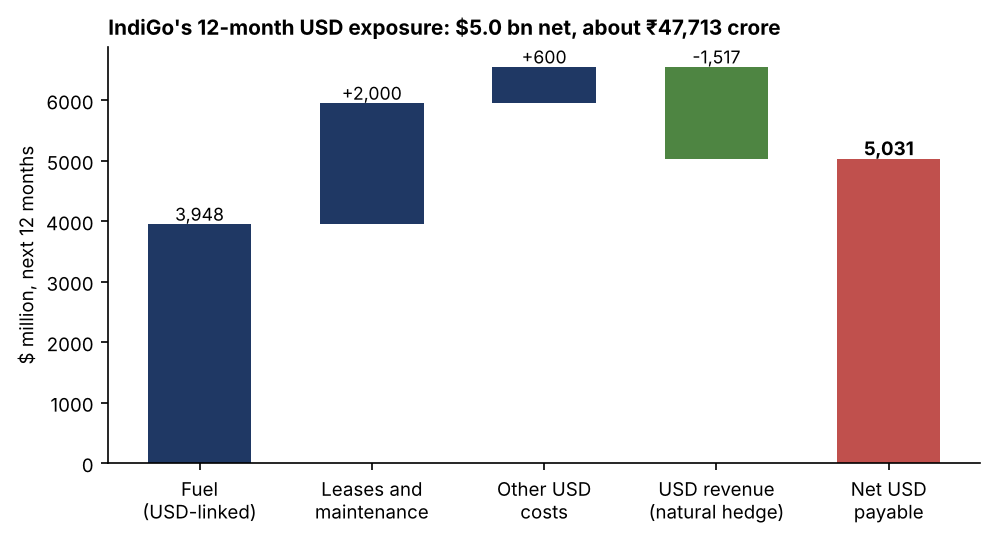
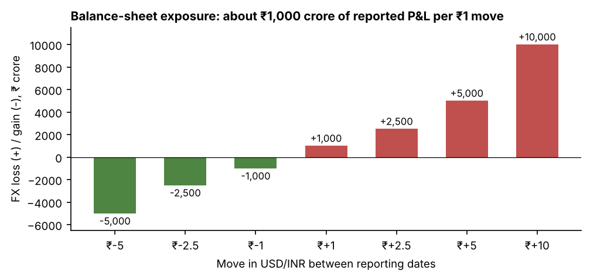
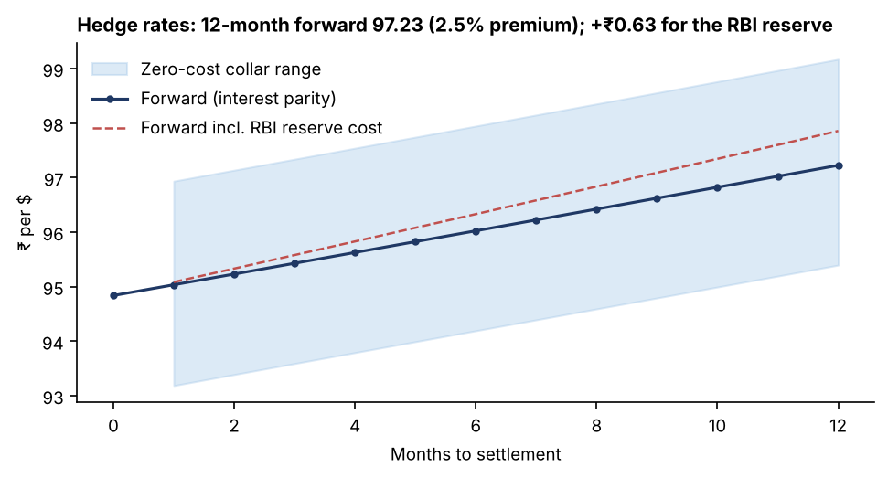
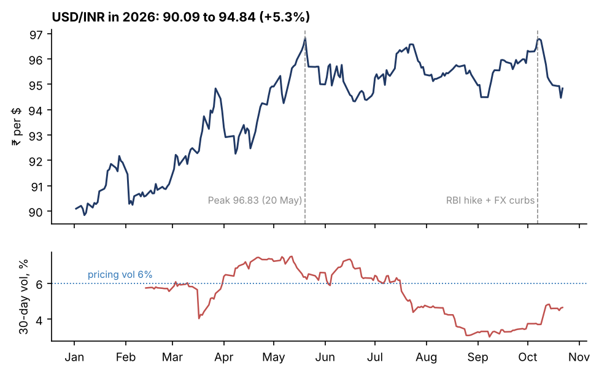
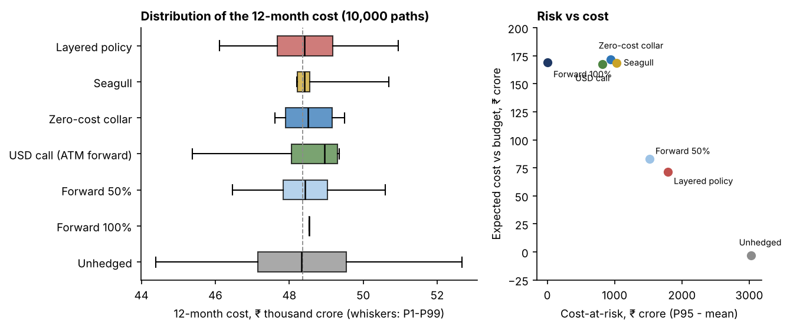
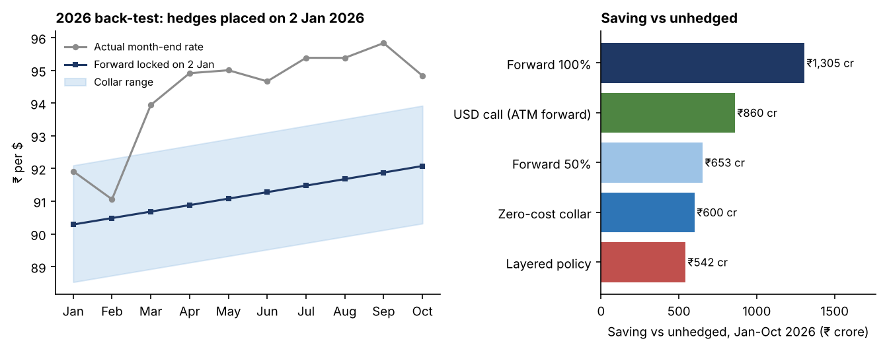

# IndiGo USD/INR hedging analysis

[](https://github.com/monisha-jasrai/IndiGo-FX-Hedging/actions/workflows/ci.yml)

How should IndiGo (InterGlobe Aviation, NSE: INDIGO), India's largest airline, hedge the rupee? This project maps its dollar exposure, prices the hedges a bank FX desk would offer (forwards, options, collars, seagulls), tests them on 10,000 simulated rupee paths and on what actually happened in 2026, and recommends a hedging policy.

Pricing date 22 Oct 2026 (USD/INR 94.84). Amounts in $ million and ₹ crore. This is a learning exercise, not hedging or investment advice.

**→ [IndiGo_FX_Hedging_Model.xlsx](IndiGo_FX_Hedging_Model.xlsx)**



## The question

IndiGo earns mostly in rupees but pays for fuel, aircraft leases and maintenance in dollars. In FY26 the rupee fell from about ₹85 to ₹94 per dollar and IndiGo swung to a ₹2,394 crore net loss, after a ₹7,258 crore profit the year before. Excluding forex and one-offs, it made ₹7,502 crore. The rupee hit a record low of about 96.8 in May 2026, and management says it has "nearly $10 billion" of dollar exposure with only about $1.3 billion hedged.

So the questions are: how big is the exposure really, what does each hedge cost, and how much should IndiGo hedge?

## 1. The exposure

There are two kinds, and they need different answers.

**Cash flow (transaction) exposure: about $5.0 bn over the next 12 months.** These are real dollars IndiGo has to pay.



| Next 12 months | $ mn | Basis |
|---|---:|---|
| Fuel, USD-linked | 3,948 | H1 FY27 fuel cost ₹20,800 crore x 2; 90% moves with USD/INR (jet fuel is priced at import parity) |
| Aircraft leases and maintenance | 2,000 | Estimate; lease liabilities are ₹53,756 crore (~$5.7 bn) |
| Other USD costs | 600 | Estimate: overseas airports, navigation, handling, parts |
| Less: revenue collected in foreign currency | (1,517) | ~30% of capacity is international; I assume half of that revenue is collected in foreign currency |
| **Net USD payable** | **5,031** | **≈ ₹47,700 crore, about half of revenue** |

Only 23% of dollar costs are offset by dollar revenue. Management wants international capacity at 40% by FY30, which would raise that natural hedge.

**Balance-sheet (translation) exposure: about ₹1,000 crore per ₹1 move.** Dollar lease liabilities are revalued at every quarter-end, so a weaker rupee shows up as a reported FX loss even though the cash is paid over 8–10 years. My figure checks out against the company's own numbers: in Q2 FY26 a ₹3.18 move produced a loss of about ₹2,900 crore, which implies about $9.1 bn of net dollar liabilities.



## 2. The hedging tools and what they cost



| Market input | Value | Source |
|---|---:|---|
| USD/INR spot | 94.84 | Bank of England reference rate, 22 Oct 2026 |
| INR rate (1 year) | 6.49% | 364-day T-bill, 14 Oct 2026 |
| USD rate (1 year) | 3.875% | Fed funds 3.75–4.00%, midpoint (assumption) |
| Volatility | 6.0% | Realised 2026: 5.5% YTD, 4.0% last 60 days, plus a buffer |
| **12-month forward** | **97.23** | Covered interest parity: 2.5% premium |



| Instrument (12-month) | Terms | Cost |
|---|---|---|
| Forward | Locks 97.23 | No premium; gives up gains if the rupee strengthens |
| USD call option at the forward | Strike 97.23 | ₹2.19 per $ upfront (2.3% of spot) |
| Zero-cost collar | Buy call 99.17, sell put 95.40 | No premium; pays between 95.40 and 99.17 |
| Seagull | Call spread 97.23–102.09, sell put ~95.7 | No premium; **protection stops above 102** |

Options are priced with Garman–Kohlhagen. The collar and seagull put strikes are solved so the net premium is zero. That matters because RBI rules don't let corporate users write options on their own or receive net premium from a structure.

**The new RBI rule adds a cost.** From 10 Oct 2026, banks must hold 20% of the rupee notional of importers' hedges as cash with RBI. If banks pass on half the lost interest, a 12-month hedge costs IndiGo about ₹0.63 per dollar more, roughly ₹170 crore on a full forward hedge. RBI also banned rebooking cancelled hedges, so a hedge you unwind can't be put back.

## 3. Results

**10,000 simulated rupee paths** (market-implied: drift equals the forward premium, 6% vol). Total cost of the next 12 months' net dollar payments, ₹ crore:

| Strategy | Expected cost | vs budget | Cost-at-risk (P95 − mean) | Worst case |
|---|---:|---:|---:|---:|
| Unhedged | 48,359 | −3 | 3,031 | 55,342 |
| Forward 100% | 48,531 | +169 | 0 | 48,531 |
| Forward 50% | 48,445 | +83 | 1,516 | 51,936 |
| USD call (at the forward) | 48,529 | +168 | 818 | 49,347 |
| Zero-cost collar | 48,533 | +172 | 946 | 49,498 |
| Seagull | 48,530 | +168 | 1,026 | 53,097 |
| **Layered policy** | **48,433** | **+72** | **1,788** | **52,298** |

Budget = the strip at today's forwards (₹48,362 crore).



What this shows:

- **At market prices, hedging doesn't make money on average.** Every strategy has about the same expected cost. The differences are the RBI reserve cost (+₹169 crore on a full hedge) and risk. A hedge is insurance, not a bet.
- **Unhedged, the bad case is ₹3,000 crore above budget,** and up to ₹7,000 crore in the worst simulated path. That's about 40% of IndiGo's FY26 underlying profit.
- **The seagull is the trap.** It looks cheap and works in normal markets, but its protection runs out above 102. In the stress scenario (8% depreciation trend, 9% vol), its worst case is ₹10,400 crore over budget, against ₹1,100 crore for a collar.

**Flat-rate scenarios** (₹ crore, if USD/INR sits at that level at every settlement):

| USD/INR | 90 | 95 | 100 | 105 |
|---|---:|---:|---:|---:|
| Unhedged | 45,280 | 47,795 | 50,311 | 52,826 |
| Forward 100% | 48,531 | 48,531 | 48,531 | 48,531 |
| Zero-cost collar | 47,608 | 47,989 | 49,498 | 49,498 |
| Seagull | 48,195 | 48,195 | 48,540 | 50,577 |
| Layered policy | 46,754 | 48,032 | 49,473 | 50,668 |

## 4. Back-test: what if IndiGo had hedged on 2 Jan 2026?

Hedges placed on 2 Jan 2026 (spot 90.09, forward premium 2.65%) for January–October payments, settled at each month's last fixing:



| Strategy | Average rate paid | Saving vs unhedged |
|---|---:|---:|
| Unhedged | 94.29 | – |
| Forward 100% | 91.18 | ₹1,305 crore |
| USD call | 92.24 | ₹860 crore |
| Forward 50% | 92.74 | ₹653 crore |
| Zero-cost collar | 92.86 | ₹600 crore |
| Layered policy | 93.00 | ₹542 crore |

2026 was the year a full hedge paid off: the rupee fell 5% and kept falling. That's one path, though, and a forward would have cost money in a year when the rupee strengthened.

## 5. Recommendation

**A layered, rolling hedge of the transaction exposure, plus balance-sheet fixes for the lease exposure.**

1. **Hedge more of the near months, less of the far months:** 75% of payments due in months 1–3, 60% in months 4–6, 45% in months 7–9 and 30% in months 10–12. Each quarter, add a new layer, so the hedge rate averages over time instead of depending on one day.
2. **Use forwards for two-thirds and zero-cost collars for one-third.** Forwards are the cheapest certainty; collars keep some benefit if the rupee recovers. No seagulls or other structures that leave the tail open.
3. **That's about $2.6 bn hedged,** roughly double today's $1.3 bn and close to management's stated plan of scaling the hedge book to $3 bn.

Why not hedge 100% with forwards, if that removes all the risk in the simulation?

- **The exposure is a forecast.** IndiGo cut capacity in Q2 FY27 (ASKs −1%, passengers −4.7%), and fuel volumes and prices move. Over-hedging turns a hedge into a speculative position.
- **Hedges are hard to undo now.** RBI's October rules ban rebooking cancelled hedges and cap hedging without proven underlying exposure.
- **Airlines compete on fares.** If the rupee recovers, a fully hedged airline is stuck with higher costs than its rivals. In the recovery scenario, a 100% forward costs ₹1,840 crore more than staying unhedged.
- **Every hedge now carries the RBI reserve cost.**

For the **translation exposure**, derivatives are the wrong tool: they create cash payments to offset a mostly non-cash accounting loss. Better levers are prepaying expensive dollar leases (IndiGo approved a $450 mn lease prepayment in May 2026), holding some cash in dollars, and growing international revenue.

## How it's built

```
config/indigo.yaml            every input, with its source
data/usdinr_2026_boe.csv      daily USD/INR, 2 Jan - 22 Oct 2026 (Bank of England)
fxhedge/pricing.py            forwards (interest parity), Garman-Kohlhagen options, zero-cost strike solver, RBI reserve cost
fxhedge/model.py              exposure map, hedge book, strategy payoffs, translation exposure
fxhedge/analysis.py           Monte Carlo, flat-rate scenarios, 2026 back-test, realised volatility
fxhedge/charts.py             charts
scripts/build_workbook.py     builds the Excel model
run.py                        runs everything: summary, charts, output/
tests/                        pricing and model tests, plus Excel-vs-Python checks
```

```bash
pip install -r requirements.txt
python run.py                  # results, charts, output/summary.json
python scripts/build_workbook.py
pytest -v                      # needs LibreOffice for the Excel checks
```

The Excel workbook is formula-driven: change the spot, volatility, exposure or hedge ratios on the Inputs tab and everything recalculates, including the zero-cost collar and seagull strikes, which the Solver tab finds with Newton's method. Only the Monte Carlo and the option back-test are pasted from Python. The tests change inputs in the workbook, recalculate it in LibreOffice and check that every forward, premium, strike and scenario total matches Python.

## Data sources

- IndiGo results: Q1 and Q2 FY27 (Kotak Neo, Free Press Journal, Oct 2026); FY26 and Q4 FY26 (Upstox, The Tribune, May 2026); Q2 FY26 forex loss and CFO comments on exposure (Business Standard, Nov 2025)
- Dollar exposure and hedge book: Hindu Business Line via LBSIM (May 2026); hedge-book expansion (Whalesbook, May 2026); international capacity share (Sahi, Aug 2026)
- USD/INR daily rates: Bank of England reference rates via Pound Sterling Live
- Rates: 364-day T-bill (Business Today, 14 Oct 2026); Fed funds after the 16 Sep 2026 hike; 1-year forward premium of 2.65% (BasisPoint Insight, Dec 2025)
- RBI rules: Foreign Exchange Risk Reserve, rebooking ban and $5 mn limit (CorpLaw Updates, Oct 2026); option rules for corporate users (RBI presentation on FX risk management, 2022)

## Limitations

- **Estimated exposure.** IndiGo doesn't publish a breakdown of its dollar cash flows. Lease, maintenance and other dollar costs, the fuel share linked to USD and the share of revenue collected in foreign currency are my estimates. All are inputs you can change.
- **FX only.** Jet fuel's dollar price is a separate, bigger risk, usually hedged with commodity swaps. Here, fuel volumes and prices are held at the H1 FY27 run-rate.
- **Flat volatility, no smile.** USD/INR options usually price dollar calls higher than puts (skew). With skew, the collar's put strike would be lower and the seagull worse.
- **Simple rate paths.** The Monte Carlo uses geometric Brownian motion with no jumps. RBI intervention tends to dampen moves, and sudden devaluations aren't modelled.
- **RBI reserve pass-through.** How much of the reserve cost banks charge is my assumption (50%).
- **Back-test inputs.** The January 2026 forward premium and volatility are approximations from market reports at the time.

## Note

I built this with help from an AI coding assistant. The choice of company, the assumptions and the analysis are my own.
